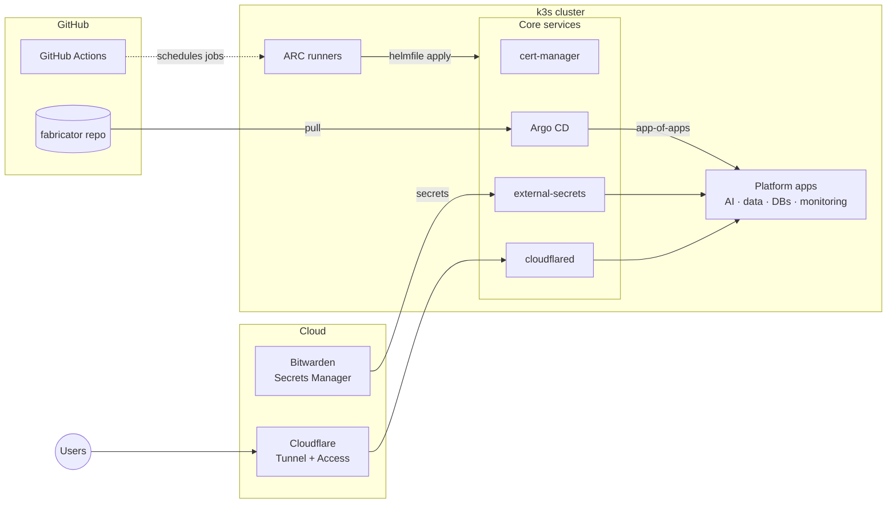

# Fabricator

**A GitOps-driven home-lab platform on Kubernetes (k3s on Raspberry Pi 5).**

Fabricator turns a few small machines into a self-hosted platform. One Ansible run builds the
cluster, one Helmfile run installs the core services, and from then on Argo CD deploys everything
else from this repository: an AI stack, data and streaming tools, databases, observability and
utilities.



## Highlights

- **Bare-metal provisioning.** Ansible with the `k3s-io/k3s-ansible` collection installs k3s on
  Raspberry Pi nodes. A local lab runs on Minikube or Vagrant/VirtualBox.
- **Pull-based GitOps.** Argo CD runs an *app-of-apps* Helm chart. You switch an application on by
  setting `enabled: true` in [`bootstrap/bootstraps.yaml`](bootstrap/bootstraps.yaml).
- **No secrets in Git.** External Secrets Operator pulls every credential from Bitwarden Secrets
  Manager. CI injects the only two bootstrap secrets as environment variables.
- **Zero-trust ingress.** A Cloudflare Tunnel exposes services, so no ports are opened on the
  home network. Cloudflare Access handles authentication and passes the user's email in a header to
  apps such as Open WebUI and Headlamp.
- **Self-hosted CI.** Actions Runner Controller (ARC) runs GitHub Actions jobs inside the cluster.
  They authenticate with their ServiceAccount, so no kubeconfig is stored anywhere.
- **Private AI stack.** LiteLLM is the gateway to hosted models, Ollama runs small local models,
  Open WebUI provides chat, Jarvis is the agent service, and an MCP server gives agents
  Kubernetes tools.

## Repository layout

```
fabricator/
├── Taskfile.yml           # Entry point: lab-on / lab-off / lab-status / lab-delete / core
├── .env.default           # Default settings for the local lab (copy to .env to override)
├── clusters/              # Local clusters: minikube (Docker) and k3s (Vagrant + VirtualBox)
├── provisioning/          # Ansible: k3s on bare metal, plus ARC runners
├── core/                  # Core services installed by Helmfile (not by Argo CD)
│   ├── helmfile.yaml      #   cert-manager → external-secrets → argo-cd → cloudflared
│   └── arc/               #   GitHub Actions Runner Controller (installed by Ansible)
├── bootstrap/             # Argo CD app-of-apps chart, plus bootstraps.yaml (the app list)
├── platforms/             # One wrapper Helm chart per application, grouped by domain
│   ├── ai/  computation/  databases/  monitoring/  operators/
│   └── security/  storage/  streaming/  ultilities/  warehouse/
├── .github/workflows/     # core.yml: validates core on PRs, applies it on merge
└── docs/                  # Detailed documentation
```

## Quick start

### Local lab (Minikube)

```bash
cp .env.default .env       # adjust CPU and memory if needed
task lab-on                # starts minikube (or Vagrant VMs if K8S_ENGINE=k3s)

# Core services need two secrets in the environment:
export CERT_MANAGER_CA_TLS_CRT="$(cat core/cert-manager/ca/tls.crt)"
export CERT_MANAGER_CA_TLS_KEY="$(cat core/cert-manager/ca/tls.key)"
export BITWARDEN_MA_ACCESS_TOKEN="<bitwarden machine-account token>"
task core                  # helmfile apply in core/
```

### Bare-metal cluster

```bash
cd provisioning
ansible-galaxy collection install -r collections/requirements.yml
task cluster                                         # k3s on the hosts in inventories/bare-metal.yml
GITHUB_ARC_ACCESS_TOKEN=<pat> task core-services     # ARC runner scale set
```

After that, merging to `master` deploys the core services through GitHub Actions. Argo CD then
syncs the applications listed in `bootstrap/bootstraps.yaml`. The full walkthrough is in
[docs/getting-started.md](docs/getting-started.md).

## Prerequisites

| Tool | Used for |
| --- | --- |
| [Task](https://taskfile.dev) | All entry-point commands |
| `kubectl`, [Helm 3](https://helm.sh), [Helmfile](https://helmfile.readthedocs.io) and the `helm-diff` plugin | Installing core services |
| [Minikube](https://minikube.sigs.k8s.io) + Docker, *or* Vagrant + VirtualBox | Local lab |
| Ansible ≥ 2.15 | Bare-metal provisioning |
| `openssl` | Generating the internal CA |
| Accounts: GitHub, Bitwarden Secrets Manager, Cloudflare (a domain with Zero Trust) | GitOps, secrets, ingress |

## Documentation

| Document | Contents |
| --- | --- |
| [Architecture](docs/architecture.md) | Layers, deployment flow, networking, hardware |
| [Getting started](docs/getting-started.md) | Setting up a local or bare-metal cluster step by step |
| [Core services](docs/core-services.md) | cert-manager, External Secrets, Argo CD, cloudflared, ARC |
| [GitOps & the app catalog](docs/gitops.md) | How `bootstrap/` works and how to add an application |
| [Platform catalog](docs/platforms.md) | Every application in `platforms/` and its status |
| [AI stack](docs/ai-stack.md) | LiteLLM, Ollama, Open WebUI, Jarvis, MCP, OpenClaw |
| [Secret management](docs/secret-management.md) | Bitwarden → External Secrets flow |
| [CI/CD](docs/cicd.md) | The `core.yml` workflow and in-cluster runners |
| [Observability](docs/observability.md) | kube-prometheus-stack, Grafana, Loki, Fluent |
| [Troubleshooting & known issues](docs/troubleshooting.md) | Common failures and open issues |

## License

Apache License 2.0. See [LICENSE](LICENSE).
