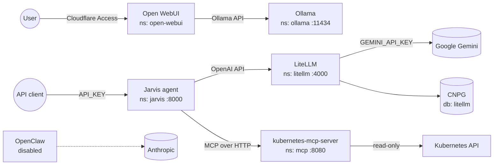

# AI stack

`platforms/ai/` contains a self-hosted LLM platform. Hosted models are reached through a single
gateway, small models run locally, and there is a chat UI and an agent with Kubernetes tools.



## LiteLLM: `platforms/ai/litellm`

This is an OpenAI-compatible proxy that sits in front of hosted model providers.

- Chart `litellm-helm` 1.108.0, image `ghcr.io/berriai/litellm:v1.85.1`, `ClusterIP` on port **4000**.
- The model list lives in [`files/config.yaml`](../platforms/ai/litellm/files/config.yaml) and is
  mounted from the `litellm-config` ConfigMap. The chart's own config map is turned off.

  ```yaml
  model_list:
    - model_name: gemini-3.6-flash
      litellm_params:
        model: gemini/gemini-3.6-flash
        max_tokens: 65536
        api_key: os.environ/GEMINI_API_KEY
  general_settings:
    master_key: os.environ/MASTER_KEY
  ```

- Its database is the shared CNPG cluster (`db.useExisting: true`, database and schema `litellm`).
  The endpoint, user and password come from `litellm-postgresql-secret`. A migration job runs on each
  sync.
- Secrets from Bitwarden: `litellm-masterkey-secret` (`MASTER_KEY`), `litellm-credentials-secret`
  (`GEMINI_API_KEY`, `DEEPSEEK_API_KEY`) and `litellm-postgresql-secret`.

**To add a model**, add an entry to `files/config.yaml`. If the provider needs a new key, put it in
Bitwarden and add it to `litellm-credentials-secret`.

## Ollama: `platforms/ai/ollama`

This runs small local models, built with `unichart`.

- Image `ollama/ollama:0.23.2` on port **11434**, with a 5 Gi PVC (`ollama-pvc`) mounted at
  `/root/.ollama`.
- **Scheduling.** It has `nodeSelector dedicated=ai_agent` and tolerates the
  `dedicated=ai_agent:NoSchedule` taint. It requests 1 CPU and 2 Gi, and can use up to 3.8 CPU and
  15 Gi. See [getting-started.md](getting-started.md#b2-install-k3s) for how to label the node.
- **Model provisioning.** A `postStart` hook runs
  [`files/init-models.sh`](../platforms/ai/ollama/files/init-models.sh) in the background. The
  script waits for the daemon, then runs `ollama create` for every `/models/<name>/Modelfile` that
  doesn't exist yet. Its log is at `/tmp/init-models.log` in the pod.
- There are Modelfiles in `files/models/` for `gemma3:1b`, `qwen3:0.6b`, `qwen3:1.7b` and
  `smollm2:135m`. All four are put into the `ollama-models` ConfigMap, but only **`smollm2:135m`**
  is currently mounted (see `volumes[].configMap.items` in `values.yaml`).

**To add a model:**

1. Create `files/models/<name>/Modelfile`.
2. Add a key for it in `templates/configmaps.yaml`.
3. Add an `items` entry in `values.yaml` that maps that key to `<name>/Modelfile`.
4. Restart the pod.

## Open WebUI: `platforms/ai/open-webui`

- Chart 14.5.0, image `ghcr.io/open-webui/open-webui:0.9.5`, with a 2 Gi PVC.
- The bundled Ollama is disabled. It uses `http://ollama.ollama.svc.cluster.local:11434` instead.
  The OpenAI API connection is off (`enableOpenaiApi: false`). You can add LiteLLM as a connection
  from the admin UI if you want hosted models.
- The bundled Redis is enabled and used as the websocket manager.
- `WEBUI_URL=https://chat.thefabricator.work`.
- **Authentication** is delegated to Cloudflare Access through
  `WEBUI_AUTH_TRUSTED_EMAIL_HEADER=Cf-Access-Authenticated-User-Email`. New users get the `user` role.

> Because it trusts that header, the Service must **only** be reachable through the Cloudflare
> tunnel. Never expose it any other way.

## Jarvis: `platforms/ai/jarvis`

This is a custom agent service, `docker.io/sondn1/jarvis:v1.0.1`, built with `unichart`, on port
**8000**.

| Env | Value |
| --- | --- |
| `LLM_API_BASE` | `http://litellm.litellm.svc:4000/v1` |
| `DEFAULT_MODEL` | `litellm_proxy/gemini/gemini-3.6-flash` |
| `ENABLE_API_KEY_AUTH` / `ENABLE_AGENT_ORCHESTRATION` | `True` |
| `MCP_CONFIG_PATH` | `/app/.config/mcp.json`, from a ConfigMap |
| `API_KEY`, `LLM_API_KEY` | `jarvis-keys-secret`, from Bitwarden |

`mcp.json` registers one MCP server, `kubernetes`, at
`http://mcp-kubernetes-mcp-server.mcp.svc:8080/mcp`.

## Kubernetes MCP server: `platforms/ai/mcp`

- Chart `kubernetes-mcp-server` 0.1.0, image `quay.io/containers/kubernetes_mcp_server:latest`,
  `ClusterIP` on port 8080. Ingress is disabled.
- RBAC: an extra ClusterRole `mcp-pod-reader` with `get/list/watch` on `apps/*`, in addition to
  what the chart grants by default.
- Values are in `kubernetes-mcp-server.yaml`, not `values.yaml`, as listed in `bootstraps.yaml`.

## OpenClaw: `platforms/ai/openclaw` (disabled)

This is an agent gateway (`ghcr.io/openclaw/openclaw:slim`) built with `unichart`.

- An init container copies `openclaw.json` and the workspace persona files (`AGENTS.md`, `SOUL.md`,
  `IDENTITY.md`, `USER.md`, `TOOLS.md`, `HEARTBEAT.md`) from a ConfigMap into
  `/home/node/.openclaw`.
- The gateway listens on **18789**, with token auth (`OPENCLAW_GATEWAY_TOKEN`) and an
  OpenAI-compatible `chatCompletions` endpoint. The control UI's allowed origin is
  `https://agent.thefabricator.work`.
- The primary model is Anthropic, using `ANTHROPIC_API_KEY` from `openclaw-secret`.
- It runs as non-root UID 1000 with the `RuntimeDefault` seccomp profile.

To turn it on, set `enabled: true` for `openclaw` in `bootstrap/bootstraps.yaml`, create the
Bitwarden secrets that `templates/secrets.yaml` refers to, and add a tunnel route.
