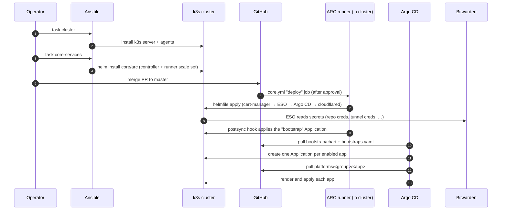
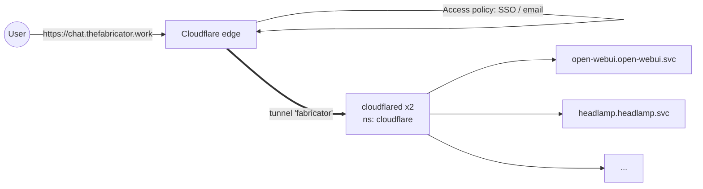

# Architecture

Fabricator is built in four layers. Each layer is installed by a different tool, and each one
depends on the layer below it.

| # | Layer | What it contains | Installed by | Lives in |
| --- | --- | --- | --- | --- |
| 1 | **Infrastructure** | Nodes and the k3s cluster | Ansible (bare metal) or Minikube/Vagrant (local) | `provisioning/`, `clusters/` |
| 2 | **CI runners** | Actions Runner Controller and the `arc-fabricator` scale set | Ansible (`kubernetes.core.helm`) | `core/arc/` |
| 3 | **Core services** | cert-manager, External Secrets, Argo CD, cloudflared | Helmfile, run by GitHub Actions or `task core` | `core/` |
| 4 | **Platforms** | AI, databases, monitoring, operators, utilities, and more | Argo CD (app-of-apps) | `bootstrap/`, `platforms/` |

## Deployment flow

### Why the core services are not managed by Argo CD

Argo CD itself needs several things to work: cert-manager provides the CA that the Bitwarden SDK
server's TLS depends on, External Secrets provides the Git credentials that Argo CD uses to read
this repository, and cloudflared provides external access. Installing all of these with Helmfile
avoids a chicken-and-egg problem. It also lets them be upgraded through a reviewed CI workflow (see
[cicd.md](cicd.md)) instead of being synced by the same tool they support.

### Why GitOps is pull-based

The cluster is on a home network with no inbound ports open. Argo CD only needs outbound HTTPS
to GitHub, so nothing has to be exposed to the internet. GitHub Actions jobs run on runners
inside the cluster that connect out to GitHub. This keeps the core deploy pipeline outbound-only
as well.

## Networking and access

- No Ingress controller or LoadBalancer is used. Every service is `ClusterIP`.
- `cloudflared` runs 2 replicas of the `fabricator` tunnel. Its credentials (`AccountTag`,
  `TunnelID`, `TunnelSecret`) come from Bitwarden through an `ExternalSecret`.
- Public hostname → service routes are set up on the Cloudflare side, in the Zero Trust dashboard,
  and are not stored in this repository.
- **Cloudflare Access** authenticates users. Apps that support header-based auth trust
  `Cf-Access-Authenticated-User-Email`:
  - Open WebUI: `WEBUI_AUTH_TRUSTED_EMAIL_HEADER`
  - Headlamp: `-proxy-auth-username-header` / `-proxy-auth-email-header`
- Services talk to each other over in-cluster DNS, for example
  `http://litellm.litellm.svc:4000/v1` and `http://ollama.ollama.svc.cluster.local:11434`.

## TLS

cert-manager runs a private CA. The key pair comes from the `CERT_MANAGER_CA_TLS_*` environment
variables, and the CA is exposed as the `ca-issuer` `ClusterIssuer`. Right now it is used for
in-cluster TLS, for example the Bitwarden SDK server certificate. Public TLS is terminated by
Cloudflare.

## Secrets

Bitwarden Secrets Manager is the only source of truth. A single `ClusterSecretStore`
(`bitwarden-secretsmanager`) serves every namespace. See [secret-management.md](secret-management.md).

## Hardware

The reference deployment is a three-node Raspberry Pi 5 cluster:

| Role | Count | Model | CPU | RAM | Storage |
| --- | --- | --- | --- | --- | --- |
| k3s server | 1 | Raspberry Pi 5 | 4× Cortex-A76 (arm64) | 16 GB | 64 GB SD card |
| k3s agent | 2 | Raspberry Pi 5 | 4× Cortex-A76 (arm64) | 16 GB | 64 GB SD card |

Things to know about this hardware:

- **arm64 only.** Every image must have an `arm64` variant. The Pi 5 kernel uses a **16 KB memory
  page size** by default. Some upstream arm64 builds assume 4 KB pages and crash (Fluent Bit was one
  of them). For those, a custom build is needed, or the node must be switched to a 4 KB kernel.
- **The `raspberrypi` role** from k3s-ansible enables cgroups and makes other Pi-specific changes
  during `task cluster`.
- **Dedicated AI node.** Ollama is pinned to nodes labelled and tainted `dedicated=ai_agent:NoSchedule`.
  It can use up to 3.8 CPU and 15 Gi of memory, which is nearly all of one Pi.
- **Storage** uses the k3s default `local-path` provisioner. PVCs are node-local, so stateful pods are
  tied to the node they were first scheduled on.

Other machines, such as `amd64` PCs or mini servers, can join as agents. Add them to the `agent`
group in `provisioning/inventories/bare-metal.yml`.
