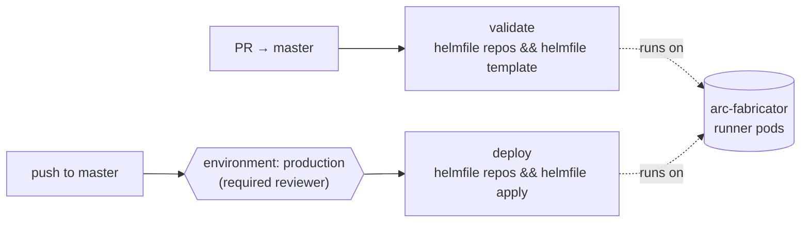

# CI/CD

Fabricator uses two delivery paths:

| What | How | Trigger |
| --- | --- | --- |
| **Core services** (`core/`) | **Push**: GitHub Actions runs `helmfile apply` on in-cluster runners | PR or merge to `master` |
| **Platform apps** (`platforms/`) | **Pull**: Argo CD syncs from Git | Commits to `lab` plus a sync, which is manual by default |

The `arc` chart is installed by Ansible (see [core-services.md](core-services.md#actions-runner-controller-arc)).

## The `Core` workflow: `.github/workflows/core.yml`



| Job | Runs when | What it does | Concurrency |
| --- | --- | --- | --- |
| `validate` | `pull_request` to `master` (opened, synchronize, reopened) | Renders every core helmfile. Nothing is applied | `core-validate-<PR#>`, cancels in-progress runs |
| `deploy` | `push` to `master` | `helmfile apply` after approval on `production` | `core-apply-master`, **does not** cancel in-progress runs, so applies run one at a time |

Other properties:

- `permissions: contents: read`, so the `GITHUB_TOKEN` is read-only.
- `actions/checkout` is pinned to a commit SHA (v4.2.2) and runs with `persist-credentials: false`.
- No tools are installed during the job. `helm`, `helmfile`, `kubectl` and `helm-diff` are already
  in the runner image.

### How the job authenticates to the cluster

Runner pods run inside the cluster as `ServiceAccount/arc-runner`, which is bound to
`cluster-admin`. `kubectl` and `helm` use the pod's projected token through in-cluster config.
There is **no kubeconfig and no cluster credential** in GitHub.

### Required GitHub configuration

**Repository secrets.** Both jobs need all three, because templating needs them as well:

| Secret | Contents |
| --- | --- |
| `CERT_MANAGER_CA_TLS_CRT` | CA certificate, raw PEM |
| `CERT_MANAGER_CA_TLS_KEY` | CA private key, raw PEM |
| `BITWARDEN_MA_ACCESS_TOKEN` | Bitwarden machine-account token |

**Environment.** Create `production` with the **Required reviewers** protection rule. Without it,
every merge is applied without anyone approving it.

## Runners

| Setting | Value |
| --- | --- |
| Scale set / `runs-on` | `arc-fabricator` |
| Min / max runners | 0 / 3 (scale to zero when idle) |
| Image | `docker.io/sondn1/arc-runner:2.336.1-rc2` |
| ServiceAccount | `arc-runner` (cluster-admin) |
| Registered to | `https://github.com/sondn98/fabricator` |

### Updating the runner image

The image is the upstream `actions-runner` with pinned versions of `helm`, `helmfile`, `kubectl`
and the `helm-diff` plugin added. It is built for **`linux/arm64`**, because the nodes are Pis.

```bash
docker buildx build --platform linux/arm64 -t <registry>/arc-runner:<tag> --push <context>
```

Then set `fabricator.template.spec.containers[0].image` in `core/arc/values.yaml` and rerun
`cd provisioning && task core-services`.

> If the cluster gains `amd64` nodes, either pin the runner pods with
> `nodeSelector: kubernetes.io/arch: arm64`, or build a multi-arch image
> (`--platform linux/amd64,linux/arm64`).

## Releasing platform changes

1. Edit `platforms/**` or `bootstrap/bootstraps.yaml`.
2. Push to `lab`, the branch Argo CD tracks.
3. Argo CD notices the change within `timeout.reconciliation` (180 s), and the app shows as
   **OutOfSync**.
4. Sync it from the UI or CLI. If `syncConfig.autoSync.enabled: true`, Argo CD syncs it for you,
   with prune and self-heal.

There is currently no CI check on `platforms/`. Before pushing, run `helm template` locally on any
chart you changed (see [gitops.md](gitops.md#add-a-new-app)).
