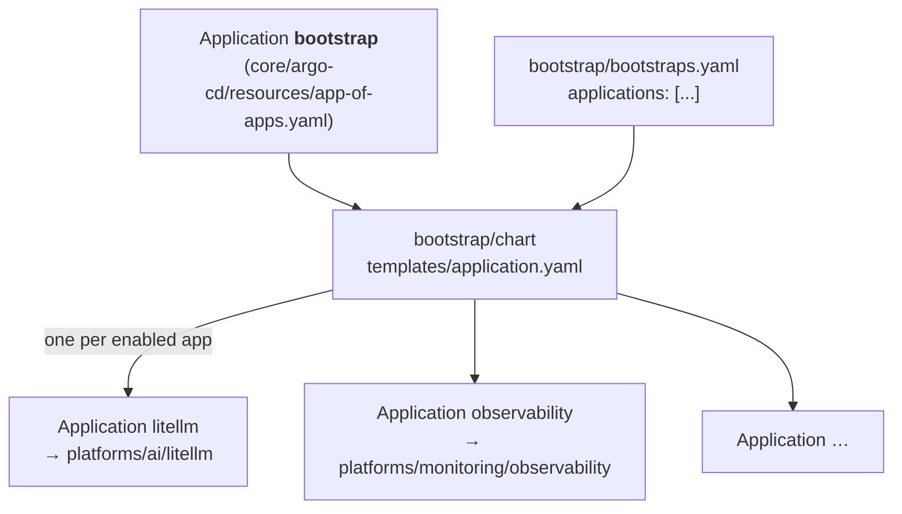

# GitOps & the app catalog

Argo CD deploys everything under `platforms/` using the **app-of-apps** pattern.



## The pieces

### `core/argo-cd/resources/app-of-apps.yaml`

This is the root Application. It is applied once by the Argo CD Helmfile `postsync` hook. It
renders the Helm chart at `bootstrap/chart` on branch **`lab`** and passes `../bootstraps.yaml` as
its values file.

### `bootstrap/chart/`

This is a small Helm chart with one template,
[`templates/application.yaml`](../bootstrap/chart/templates/application.yaml). The template loops
over `.Values.applications` and creates an `argoproj.io/v1alpha1 Application` for each item where
`enabled: true`:

- `source.repoURL` and `targetRevision` come from `global`. `source.path` is `app.path`.
- `helm.releaseName` is `app.name`. `helm.valueFiles` is `app.valueFiles`, with paths relative to
  `app.path`. `helm.parameters` is `app.extraParams`, and `helm.valuesObject` is `app.extraValues`.
- `destination.namespace` is `app.namespace`, on `global.kubeServer`, which defaults to the
  in-cluster API.
- `syncPolicy` comes from `syncConfig`, which is shared by all applications.

`bootstrap/chart/values.yaml` documents every field and sets these defaults:

| Setting | Default | Effect |
| --- | --- | --- |
| `global.kubeVersion` | `1.30.0` | Kube version passed to Helm templating |
| `global.revisionHistoryLimit` | `3` | Rollback history kept per app |
| `syncConfig.autoSync.enabled` | **`false`** | Apps are synced **by hand**. Set to `true` to enable automated sync with `prune` and `selfHeal`, plus 5 retries with backoff |
| `syncOptions.CreateNamespace` | `true` | Each app's namespace is created automatically |
| `syncOptions.ApplyOutOfSyncOnly` | `true` | Only resources that are out of sync are applied |
| `syncOptions.PruneLast` / `PrunePropagationPolicy` | `true` / `foreground` | Order of deletions during a sync |
| `syncOptions.Validate` | `false` | Skips `kubectl --validate` |

### `bootstrap/bootstraps.yaml`

This is the **catalog**: the one file you edit to decide what runs in the cluster.

```yaml
global:
  repoURL: https://github.com/sondn98/fabricator.git
  targetRevision: lab
  appNamespace: argo

applications:
  - name: litellm              # Application name and Helm release name
    enabled: true              # false = no Application is created (Argo prunes the old one)
    namespace: litellm         # destination namespace (created automatically)
    path: platforms/ai/litellm # chart directory in this repo
    valueFiles:                # relative to `path`
      - values.yaml
    extraParams:               # optional: --set style overrides
      - name: "foo.enabled"
        value: "true"
```

## The wrapper-chart convention

Each directory under `platforms/<group>/<app>/` is a **wrapper chart**:

```
platforms/ai/litellm/
├── Chart.yaml           # depends on the upstream chart at a pinned version
├── values.yaml          # upstream values, nested under the dependency name
├── templates/
│   ├── secrets.yaml     # ExternalSecrets for this app
│   └── configmap.yaml   # extra resources the upstream chart doesn't provide
└── files/               # config files loaded with .Files.Get
```

- Upstream values go under a key named after the dependency (or its alias), for example
  `litellm-helm:` and `kube-prometheus-stack:`.
- Settings can be split across several files. For example, `observability` has a separate file for
  Grafana, Prometheus, Alertmanager and so on, and lists them all in `valueFiles`.
- Some charts are **vendored** as `.tgz` files or source under `charts/` (JupyterHub, NiFi, Fluent
  Operator, code-server, pgbouncer) when they are patched or unavailable from a repository.
- **`unichart`** (`oci://ghcr.io/sondn98/charts`, v1.0.1) is a reusable chart for apps that don't
  have an upstream chart, such as Jarvis, Ollama, OpenClaw, DBGate and Toolbox. You describe the
  Deployment (image, ports, env, volumes, probes), the Service, an optional PVC, ConfigMaps and RBAC
  under the `unichart:` key.

## Common tasks

### Enable or disable an existing app

1. Set `enabled: true` or `false` in `bootstrap/bootstraps.yaml`.
2. Push to the branch that Argo CD tracks (`lab`).
3. Sync `bootstrap` in Argo CD, then sync the new child Application.

### Add a new app

1. Create `platforms/<group>/<app>/Chart.yaml`:

   ```yaml
   apiVersion: v2
   name: my-app
   version: 1.0.0
   appVersion: 1.0.0
   description: A helm chart for my-app deployed through argocd
   dependencies:
     - name: my-app              # or: unichart, version 1.0.1, oci://ghcr.io/sondn98/charts
       version: x.y.z
       repository: https://charts.example.com
   ```

2. Add `values.yaml`, with the upstream values nested under `my-app:`.
3. Put credentials in Bitwarden and reference them from `templates/secrets.yaml`. See
   [secret-management.md](secret-management.md).
4. Check that it renders:

   ```bash
   cd platforms/<group>/<app>
   helm dependency update && helm template my-app . -f values.yaml | less
   ```

5. Add an entry to `bootstrap/bootstraps.yaml` under the right group heading.
6. If the app needs to be reachable from outside, add a public hostname to the Cloudflare tunnel
   that points at `http://<svc>.<ns>.svc:<port>`, and protect it with an Access policy.

### Change the tracked branch

The branch is set in **three** places, and they must all match:
`core/argo-cd/resources/app-of-apps.yaml` (`targetRevision`), and `global.targetRevision` in both
`bootstrap/bootstraps.yaml` and `bootstrap/chart/values.yaml`.
