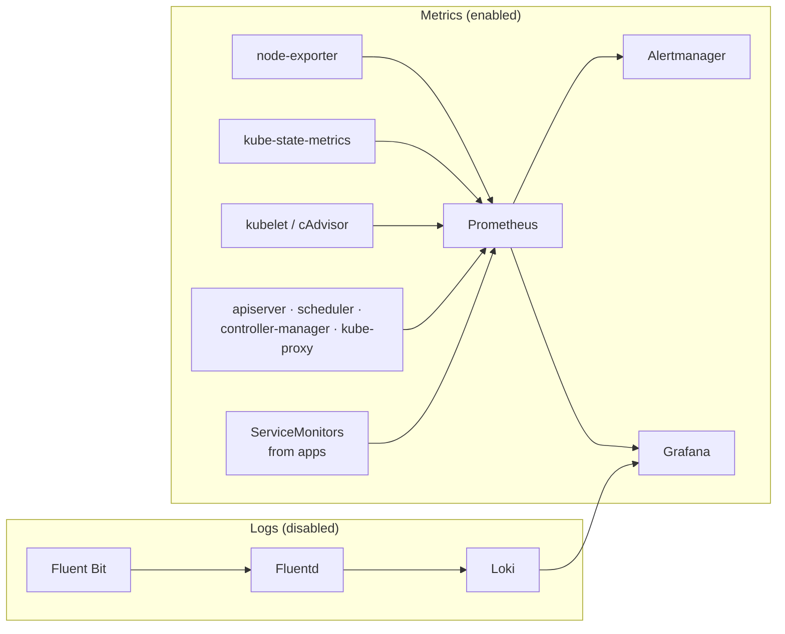

# Observability

Observability covers **metrics** (enabled) and **logs** (defined, currently disabled).



## Metrics: `platforms/monitoring/observability`

This wraps **kube-prometheus-stack 87.2.0**, deployed to the `observability` namespace. The values
are split by component, and `bootstraps.yaml` lists every file:

| File | Configures |
| --- | --- |
| `values.yaml` | CRDs and the default rule groups: all upstream recording and alerting rules, with runbooks linked to `runbooks.prometheus-operator.dev` |
| `prometheus.yaml` | Prometheus Operator v0.92.0 (TLS 1.3 webhook), the Prometheus server (`:9090`), and node/windows-exporter scrape settings |
| `alert-manager.yaml` | Alertmanager (`:9093`) with standard inhibition rules |
| `grafana.yaml` | Grafana with default dashboards (UTC, editable). The admin login comes from `grafana-auth-secret` |
| `kube.yaml` | Control-plane and kubelet scraping, with metric drop rules to keep cardinality down |
| `node-exporter.yaml` | Linux node-exporter only |
| `thanos.yaml` | Thanos Ruler, disabled |
| `dashboards/node-exporter-full.json` | Node Exporter Full dashboard |

### What is scraped

- **Kubernetes components:** the API server (with high-cardinality histogram buckets dropped),
  kubelet with cAdvisor every 10 s (with noisy `container_*` series and CNI interfaces dropped),
  controller-manager, scheduler, kube-proxy on `:10249`, and kube-state-metrics.
- **Disabled:** CoreDNS/kube-dns and etcd. k3s uses an embedded datastore and doesn't expose these
  the usual way.
- **Apps:** anything that creates a `ServiceMonitor` or `PodMonitor` with the release label. Charts
  that ship one include NiFi, Airflow (through a StatsD exporter), and Argo CD and cert-manager
  if you enable their metrics.

### Alerting

Alertmanager routes everything to a `null` receiver. Alerts are evaluated and appear in the UI, but
**no notifications are sent**. To get notifications, add a receiver such as Slack, Telegram or email
in `alert-manager.yaml`, and store its credentials in Bitwarden.

### Accessing the UIs

There are no ingresses. Use a port-forward or a Cloudflare tunnel route:

```bash
kubectl -n observability port-forward svc/observability-grafana 3000:80
kubectl -n observability port-forward svc/observability-kube-promet-prometheus 9090
kubectl -n observability port-forward svc/observability-kube-promet-alertmanager 9093
```

Service names follow the release name `observability`. Run `kubectl -n observability get svc` to
see the exact names.

## Logs (disabled)

The pieces are in the repository, but none are enabled yet:

| App | Role |
| --- | --- |
| `operators/fluent` | Fluent Operator 3.1.0 (vendored). Fluent Bit collects container logs and Fluentd forwards them |
| `operators/fluent/templates/fluentd-outputs.yaml` | A `ClusterOutput` that sends to `loki-grafana-loki-distributor.loki.svc:3100`, with Kubernetes labels extracted |
| `monitoring/loki` | Bitnami `grafana-loki` 4.6.15 |

To enable logging:

1. Enable `loki`, then `fluent`, in `bootstrap/bootstraps.yaml`.
2. Add Loki as a Grafana data source: `http://loki-grafana-loki-gateway.loki.svc`.
3. **Raspberry Pi 5:** official Fluent Bit arm64 builds assume 4 KB memory pages and may crash on
   the Pi 5's default 16 KB-page kernel. Use a build made for 16 KB pages, or boot the node with
   `kernel=kernel8.img` (4 KB pages).
4. The Bitnami Loki images may no longer be published. You may need to switch to the official
   `grafana/loki` chart. See [platforms.md](platforms.md).
