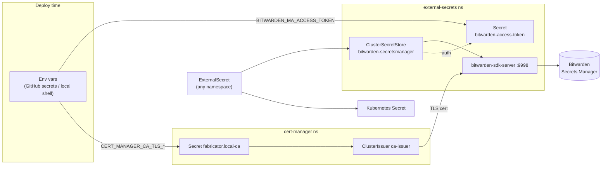

# Secret management

**There are no plaintext secrets in Git.** Every credential the cluster uses comes from one of two
places:

1. **Bitwarden Secrets Manager.** External Secrets Operator (ESO) reads every runtime secret from it.
2. **Environment variables at deploy time.** These are only for the secrets ESO needs before it can
   reach Bitwarden.



## Bootstrap secrets

These are injected with Helmfile's `requiredEnv`, which aborts templating if a variable isn't set.

| Variable | Rendered into | Used for |
| --- | --- | --- |
| `CERT_MANAGER_CA_TLS_CRT` | `cert-manager/Secret fabricator.local-ca` (`tls.crt`) | Private CA certificate |
| `CERT_MANAGER_CA_TLS_KEY` | `cert-manager/Secret fabricator.local-ca` (`tls.key`) | Private CA key |
| `BITWARDEN_MA_ACCESS_TOKEN` | `external-secrets/Secret bitwarden-access-token` (`token`) | ESO's credential for Bitwarden |
| `GITHUB_ARC_ACCESS_TOKEN` | ARC `githubConfigSecret.github_token` (through Ansible) | Registering runners |

Pass the **raw** values: the PEM as generated and the token as issued. The templates apply
`b64enc` themselves. In CI these are GitHub Actions secrets (see [cicd.md](cicd.md)). Locally, export
them in your shell.

## The ClusterSecretStore

`core/external-secrets/secret-store/bitwarden/secret-store.yaml` defines
`ClusterSecretStore/bitwarden-secretsmanager`:

- Provider `bitwardensecretsmanager`, using `api.bitwarden.com` and `identity.bitwarden.com`.
- A fixed `organizationID` and `projectID`. **Change these if you fork the repository.**
- ESO doesn't call Bitwarden directly. It calls the in-cluster **Bitwarden SDK server** at
  `https://bitwarden-sdk-server.external-secrets.svc.cluster.local:9998`. That connection uses a
  certificate issued by `ca-issuer`, and ESO trusts it through `caProvider` → `bitwarden-tls-certs/ca.crt`.

## Using a secret in an app

1. In Bitwarden Secrets Manager, create the secret in the Fabricator project and copy its **ID**
   (a UUID).
2. Add an `ExternalSecret` to `platforms/<group>/<app>/templates/secrets.yaml`:

   ```yaml
   apiVersion: external-secrets.io/v1beta1
   kind: ExternalSecret
   metadata:
     name: my-app-secret
   spec:
     refreshInterval: 1h
     target:
       name: my-app-secret          # name of the Kubernetes Secret to create
     data:
       - secretKey: API_KEY          # key inside that Secret
         sourceRef:
           storeRef:
             name: bitwarden-secretsmanager
             kind: ClusterSecretStore
         remoteRef:
           key: 00000000-0000-0000-0000-000000000000   # Bitwarden secret ID
           version: v1
   ```

3. Reference it from the app's values, for example with `valueFrom.secretKeyRef`, `existingSecret`
   or `environmentSecrets`.

### Templated secrets

If you need to build a file or connection string from several values, use `target.template`.
`core/cloudflared/secret/cloudflared-secret.yaml` does this to build `credentials.json`, and the
Argo CD repository secret uses it to add the `argocd.argoproj.io/secret-type: repository` label.

```yaml
target:
  template:
    data:
      credentials.json: |
        { "AccountTag": "{{ .accountId }}", "TunnelID": "{{ .tunnelId }}", "TunnelSecret": "{{ .tunnelSecret }}" }
```

## Where secrets are used

| Namespace | ExternalSecret | Contents |
| --- | --- | --- |
| `argo` | `argocd-github-fabricator-secret` | GitHub username and token for the repository |
| `cloudflare` | `cloudflare-secret` | Tunnel credentials |
| `cnpg` | `cnpg-superuser-secret`, `cnpg-initdb-secret` | Postgres superuser, role-creation SQL |
| `litellm` | `litellm-masterkey-secret`, `litellm-credentials-secret`, `litellm-postgresql-secret` | Proxy master key, provider API keys, DB connection |
| `jarvis` | `jarvis-keys-secret` | Service API key, LiteLLM key |
| `observability` | `grafana-auth-secret` | Grafana admin user and password |
| `headlamp` | `oidc-secret` | OIDC client and issuer (for when OIDC is turned on) |
| others (disabled apps) | `templates/secrets.yaml` in each chart | Database and admin passwords |

## Rotation

- **Bitwarden-backed secrets** refresh every `refreshInterval` (1 h for apps, 10 m in core). Most
  workloads read secrets only at startup, so restart them after a rotation with
  `kubectl rollout restart`.
- **The CA** is valid for 365 days. Generate a new pair, update both GitHub secrets, and rerun the
  core deploy. cert-manager then re-issues the certificates that depend on it.
- **The Bitwarden machine-account token**: update the GitHub secret and redeploy the core services.
